# h2 Voileipä

## x) Lue ja tiivistä

**Karvinen 2026: Sudo without password**

Ohjeissa kerrotaan miten luodaan sudoless ryhmä ja johon lisästyt käyttäjät voivat suorittaa sudo komentoja ilman, että järjestelmä pyytää salasanaa.

Ennen muutoksien tekoa on hyvä avata yksi terminaali auki ja jättää se auki root oikeuksilla `sudo -i` mikäli muutokset aiheuttaisivat ongelmia.

Seuraavaksi tulee luoda uusi käyttäjä `sudo adduser antero` ja ryhmä `sudo groupadd sudoless`. Tämän jälkeen luotu käyttäjä lisätään luotuun ryhmään `sudo adduser antero sudoless`.
Sen jälkeen ryhmän käyttöoikeuksia muokataan `sudo visudo /etc/sudoers.d/sudoless` ja annetaan kaikille ryhmän käyttäjille mahdollisuus suorittaa sudo komentoja ilman salasanakyselyä, 
lisäämällä tiedostoon teksti `%sudoless ALL = (ALL) NOPASSWD: ALL`.

**Munroe 2006: xkcd 149: Sandwitch**

-Tässä sarjakuvassa havainnoitiin sitä, että jotkin komennot vaativat sudo oikeuksia.
ilman niitä komentoa ei toteuteta.

**Karvinen 2026: Passwordless Sudo with Ansible **

Ohjeissa kerrotaan miten automatisoida uuden käyttäjän luominen ja salasanaton kirjautuminen.
Tuo ohjeissa ollut main.yml pohja on ihan hyödyllinen mikäli joutuisi luomaan useampia vastaavia käyttäjiä niin sitä voi käyttää pohjana.
SSH-avaimen kanssa pitää vain olla tarkkana, että muistaa käyttää aina omaa julkista avainta eikä netissä olevien ohjeiden mahdollisia valmiita esimerkkiavaimia.

**Ansiblen sisäänrakennettu dokumentaatio**

'ansible-doc copy'
-Kopioi tiedoston tai kansion paikalliselta tai etäkoneelta toiselle koneelle.  
content= luo tiedoston jos sitä ei ole jo olemassa.  
dest= kohde johon tiedot kopioidaan.  
src= paikallinen tiedoston sijainti.  
owner= tiedoston uusi omistaja.  
group= tiedoston uusi ryhmä.  
mode= käyttöoikeudet.  

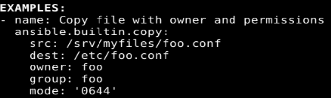

'ansible-doc apt'  
- Hoitaa apt paketteja.  
name= valitun paketin nimi  
state= haluttu tila paketille  
update_cache= pakettiluettelon päivitys  

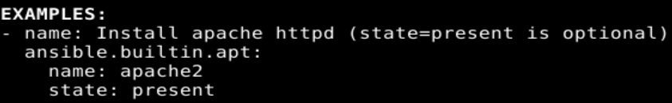

'ansible-doc file'
- Määrittää tiedostojen, kansioiden ja symbolisten linkkien ominaisuuksia.  
path= käsiteltävän tiedoston tai kansion sijainti  
recurse= oikeuksien muutos myös alihakemistoihin  
src= polku tiedostoon joka linkataan  
state= haluttu tila   
owner= tiedoston omistaja  
group= tiedoston ryhmä  
mode= käyttöoikeudet  

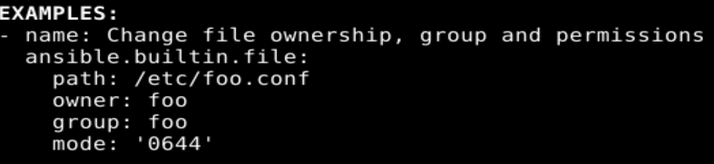

'ansible-doc user'
- Hallinnoi käyttäjätilejä ja niiden ominaisuuksia.  
name= käyttäjätunnus  
create_home= kotihakemiston luominen käyttäjälle  
comment= kommentti  
groups= käyttäjän ryhmät  
shell= käyttäjälle valittu shell  
state= halutaanko käyttäjä poistaa vai luoda  
system= halutaanko tehdä järjestelmäkäyttäjä  

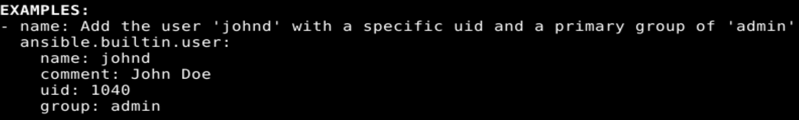

'ansible-doc authorized_key'
- Lisää tai poistaa SSH-avaimia määritetyiltä käyttäjätileiltä.
user= käyttäjä kenen avaimia muokataan.  
key= julkinen SSH-avain  

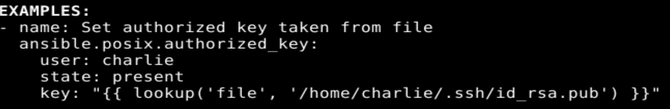

**Tehtävissä käytetyn laitteen tiedot:**

Lenovo kannettava tietokone
- Käyttöjärjestelmä: Win 11 Home
- Prosessori: Intel i7 10th gen
- RAM-muisti: 32 Gt
- Tallennustila: 512 GB

Ohjelmisto ja VM jolla harjoitus tehty
- Virtualisointiohjelma: Oracle VirtualBox
- Käyttöjärjestelmä: Debian GNU/Linux 13 (Trixie)
- Virtuaalikoneen prosessorit: 2 vCPU
- RAM-muisti: 8 Gt
- Virtuaalilevy: 60 Gt, dynaamisesti varattu

## a) Sudoless
**Päivämäärä:** 9.11.2026

Avasin aluksi kaksi terminaalia ja toiseen kirjoitin komennon `sudo -i` ja jätin sen auki taustalle. Tämä sen vuoksi, jos muutoksien kanssa tulee ongelmia niin voin vielä yrittää korjata niitä taustalle 
jätetystä terminaalista.

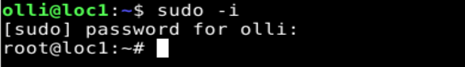

Seuraavaksi loin uuden käyttäjän `sudo adduser ansol` ja ryhmän `sudo groupadd sudoless`. Tämän jälkeen lisäsin uuden käyttäjän luotuun ryhmäään `sudo adduser ansol sudoless`.
Sen jälkeen muokkasin ryhmän käyttöoikeuksia komennolla `sudo visudo /etc/sudoers.d/sudoless` ja annoin kaikille ryhmän jäsenille oikeudet suorittaa sudo komentoja ilman salasanakyselyä. 
Se onnistui kun lisäsin tiedostoon tekstin `%sudoless ALL = (ALL) NOPASSWD: ALL`.

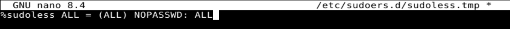

Siirsin vielä julkisen avaimen omalta käyttäjältäni ansolille `ssh-copy-id ansol@localhost`.

Tämän jälkeen kirjauduin ssh kautta ansol käyttäjälle localhostiin `ssh ansol@localhost`. Ansol käyttäjänä tein vielä ssh yhteyden localhostiin `ssh localhost` ja hyväksyin ssh-avaimet. Kirjauduin ulos `exit` ja kokeilin
toimiko sudo ilman salasanaa komennoilla `sudo -k` ja `sudo echo testi` ja se toimi. 

## b) Antero
**Päivämäärä:** 9.11.2026

Aloitin tehtävän luomalla tarvittavat kansiot ja tiedoston komennoilla `mkdir -p ~/ansible/roles/antero/tasks/` ja `nano ~/ansible/roles/antero/tasks/main.yml`. Kirjoitin main.yml sisään seuraavat tiedot:

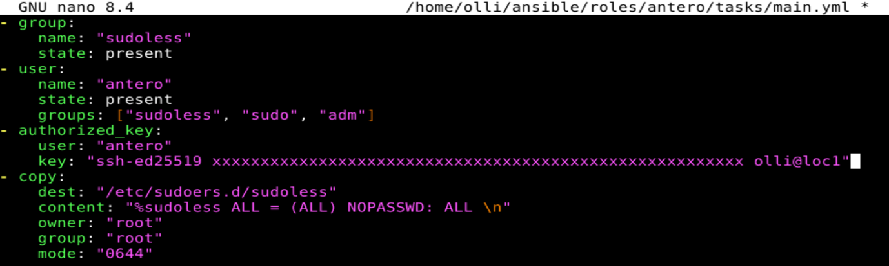

Sen jälkeen muokkasin site.yml tiedostoa `nano ~/ansible/site.yml` lisäämällä sinne tekstin `become: true` ja roolin `antero` sekä poistin roolit `hello` ja `curler` jotka olivat siellä tällä hetkellä turhana.

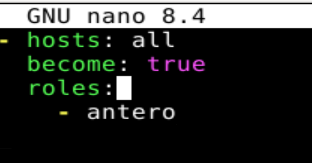

Seuraavaksi annoin komennon `ansible-playbook site.yml` ja sain odotetun virheen "Task failed: Missing sudo password". 
Syötin komennon uudelleen tällä kertaa muodossa `ansible-playbook site.yml --ask-become-password` ja sain ansiblen käyttöohjeen ruudulle. 
Korjasin komennon vielä kerran uudelleen muotoon `ansible-playbook site.yml --ask-become-pass` jonka jälkeen se toimi. Syötin sen vielä tuon jälkeen uudelleen ja toisella kerralla ei enäää tullut lisää muutoksia,
koska tila oli jo halutussa muodossa eikä muutoksia tarvittu.

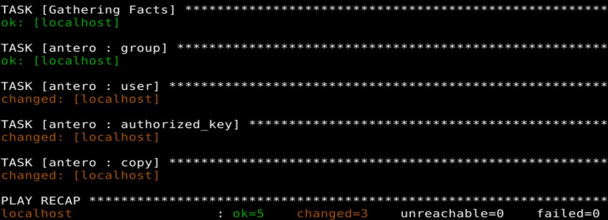
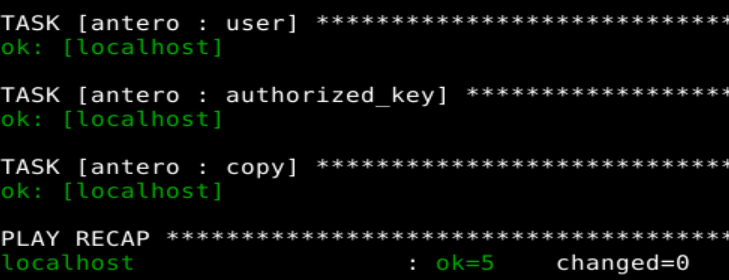

Lopuksi kokeilin vielä, että kaikki toimii `ssh antero@localhost` `sudo -k` `sudo echo testi` kaikki meni läpi ilman kirjoittamatta salasanoja.

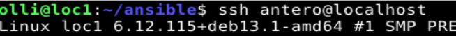
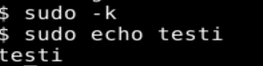

## c) Package
**Päivämäärä:** 9.11.2026

Loin aluksi kansiot `mkdir -p roles/bob/tasks` ja sitten tiedoston `nano roles/bob/tasks/main.yml` johon lisäsin tiedot:

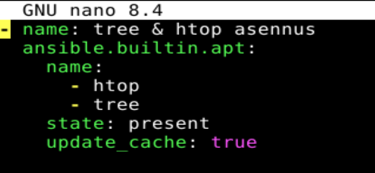

Sen jälkeen lisäsin `bob` roolin site.yml tiedostoon `nano ~/ansible/site.yml` ja poistin muut.

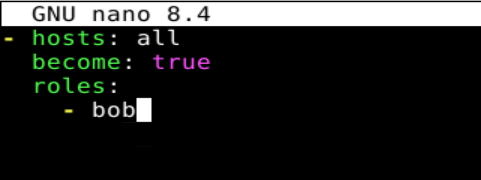

Testasin seuraavaksi toimiko kaikki `ansible.playbook site.yml --ask-become-pass` ja kaikki toimi ansible asensi htop ja tree paketit. Kokeilin vielä uudelleen samaa komentoa eikä lisää muutoksia tullut.

## d) File
**Päivämäärä:** 9.11.2026

Loin aluksi kansiot `mkdir -p roles/teksti/tasks` ja sitten tiedoston `nano roles/teksti/tasks/main.yml` johon lisäsin tiedot:

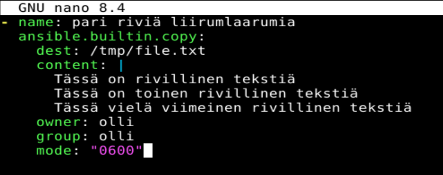

Tässä haluttiin, että ansible luo teksti tiedoston ja tallentaa sen /tmp/ kansioon nimellä file.txt, tiedoston sisälle tulee kolme riviä tekstiä. Oikeuksiksi tiedostolle määritetään vain käyttäjälle olli luku- ja
kirjoitusoikeus.
Sen jälkeen lisäsin `teksti` roolin site.yml tiedostoon `nano ~/ansible/site.yml`.

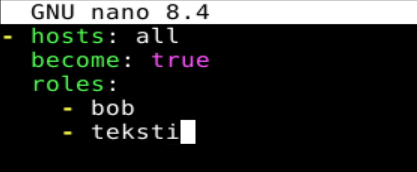

Testasin seuraavaksi toimiko kaikki `ansible.playbook site.yml --ask-become-pass` ja ansible sai luotua tekstitiedoston jonka tarkistin `cat /tmp/file.txt`. Kokeilin vielä uudelleen samaa komentoa eikä lisää muutoksia tullut.

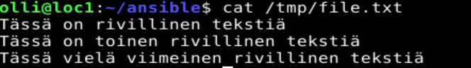

Oikeudet tiedostolle olivat "0600" eli "-rw-------", joten vain käyttäjä olli sai lukea ja kirjoittaa tiedostoa ryhmät tai muut eivät saaneet tiedostoon mitään käyttöoikeuksia.

## e) Jotain muuta

Loin aluksi kansiot `mkdir -p roles/scan/tasks` ja sitten tiedoston `nano roles/scan/tasks/main.yml` johon lisäsin tiedot:

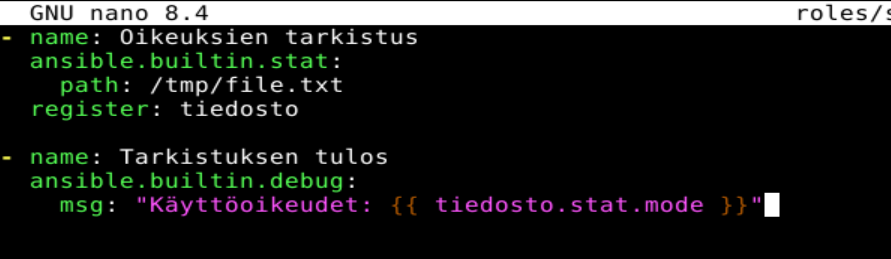

Tämän ideana on tarkistaa luodun file.txt tiedoston käyttöoikeudet ja tallentaa sen tiedot muuttujaan. Toinen toiminto lukee muuttujan ja ilmoittaa mitkä sen käyttöoikeudet ovat.
Sen jälkeen lisäsin `scan` roolin site.yml tiedostoon `nano ~/ansible/site.yml`.

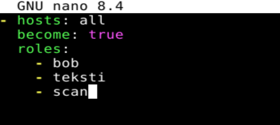

Testasin seuraavaksi toimiko kaikki `ansible.playbook site.yml --ask-become-pass` ja kaikki toimi sekä sain ilmoituksen käyttöoikeuksien tasosta.

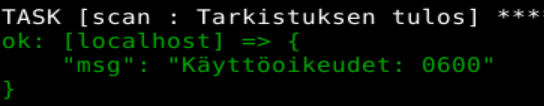

## Lähteet

- Karvinen, T. 2026 Palvelinten Hallinta h2 voileipä. Luettavissa: https://terokarvinen.com/palvelinten-hallinta/ Luettu 9.11.2026
- Karvinen, T. 2026 Passwordless Sudo with Ansible Luettavissa: https://terokarvinen.com/passwordless-sudo-with-ansible/ Luettu 9.11.2026
- Karvinen, T. 2026 Sudo without password Luettavissa: https://terokarvinen.com/passwordless-sudo/ Luettu 9.11.2026
- Munroe 2006 xkcd 149: Sandwitch Luettavissa: https://xkcd.com/149/ Luettu 9.11.2026
- OpenAI ChatGPT (GPT-6), tekninen neuvonta Ansiblen toiminnoista, 9.11.2026
