# h3 Demoni

## x) Lue ja tiivistä

Karvinen 2026: Apache installed with Ansible - quick notes

Tässä neuvottiin, miten voidaan asentaa Apache 2 verkkopalvelin automaattisesti Ansiblen avulla.   
Hyvänä vinkkinä oli, että palvelu pitää käynnistää uudelleen, kun sen asetuksiin tehdään muutosia. Sen vuoksi on tärkeä luoda handler-tiedosto, joka hoitaa uudelleenkäynnistyksen.

Ansible Community Documentation: Handlers: running operations on change

Näissä ohjeissa kerrottiin tarkemmin handlereistä. Niitä voidaan käyttää, kun halutaan ajaa tehtäviä, esimerkiksi uudelleenkäynnistys vain kun järjestelmään on tehty muutoksia. 
Handlereille lähetetään ohje aktivoitua `notify` avainsanalla. Handlereitä voi olla myös useampia ja niitä on mahdollista aktivoida useampia kerralla. Mikäli samaa handleria kutsuttaisiin useampaan kertaan, se aktivoituu kuitenkin vain yhden kerran, jotta sama palvelu ei käynnistyisi useaan kertaan uudelleen.
Hyvänä vinkkinä oli, että handlerit aktivoituvat tietyssä järjestyksessä ja se on järjestys, jossa ne ovat handlers-listalla. `Notify` järjestyksellä ei ole väliä, joten tämä on hyvä pitää mielessä, mikäli jokin palvelu pitää käynnistää ennen muita. 

ansible-doc service

MODULE
-Kontroloi palveluita etäkoneilla. Module toimii proxynä palvelunhallintaohjelmalle ja ohjaa kaikki komennot sille. Kaikki palvelunhallintaohjelmat eivät kuitenkaan tue samoja käskyjä. Module toimii myös proxynä usealle erityiselle palvelunhallintaohjelmalle.
enabled= Määrittää, pitääkö palvelun käynnistyä koneen käynnistyksessä.
name= Määrittää palvelun nimen
state= Määrittää tilan, jossa palvelun pitäisi olla. 

EXAMPLES:

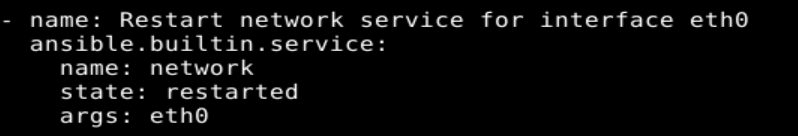

## y) Hacker News
Tässä https://aishippingblog.com/p/how-i-dropped-our-production-database/comments artikkelissa kerrotaan, miten tekoäly tuhosi tietokannan kun käyttäjä oli antanut sille turhan laajat oikeudet toteuttaa käskyjä. Tapahtunut oli käyttäjävirhe, mutta hyvä esimerkki siitä, ettei kaikkea kannata yrittää automatisoida täysin sokkona. Käyttäjä sanoikin jatkossa tarkistavansa itse komennot ennen kuin niitä suoritetaan, jotta vastaavaa ei tapahtuisi uudelleen.

**Tehtävissä käytetyn laitteen tiedot:**

Lenovon kannettava tietokone
- Käyttöjärjestelmä: Win 11 Home
- Prosessori: Intel i7 10th gen
- RAM-muisti: 32 Gt
- Tallennustila: 512 GB

Ohjelmisto ja VM, jolla harjoitus tehty (loc1)
- Virtualisointiohjelma: Oracle VirtualBox
- Käyttöjärjestelmä: Debian GNU/Linux 13 (Trixie)
- Virtuaalikoneen prosessorit: 2 vCPU
- RAM-muisti: 8 Gt
- Virtuaalilevy: 60 Gt, dynaamisesti varattu

VPS palvelu ja VM, mihin apache sekä nginx asennettiin (vps2)
- Palveluntarjoaja: UpCloud
- Käyttöjärjestelmä: Debian GNU/Linux 13 (Trixie)
- Virtuaalikoneen prosessorit: 1 vCPU
- RAM-muisti: 1 Gt
- Virtuaalilevy: 250 Gt

## a) Apassi
**Päivämäärä:** 17.11.2026
Aloitin tehtävän päivittämällä pakettiluettelon `sudo apt update` ja asentamalla apache2 `sudo apt install apache2`.
Kun apache2 oli asentunut, tarkistin näkyykö sivusto `curl localhost` ja sain testisivun tiedot.
Tarkistin vielä seuraavaksi millä palvelimella sivusto pyöri `curl -sI localhost | grep Server` 

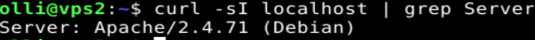

Muutin seuraavaksi index.html tiedoston käyttöoikeudet jotta etusivua voi muokata. 
Tein sen käskyillä `sudo chown olli:olli /var/www/html/index.html` ja `sudo chmod 644 /var/www/html/index.html` ja tarkistin vielä lopuksi käyttöoikeudet `ls -l /var/www/html/index.html`. 

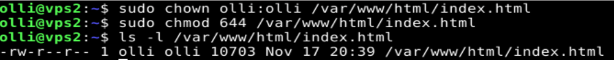

Muokkasin seuraavaksi index.html tiedostoa komennolla `echo "TESTI APACHE2" >  /var/www/html/index.html`, joka poisti sieltä kaiken ja jätti tilalle vain viestin TESTI APACHE2.
Tarkistin vielä, oliko muutos näkyvillä `curl localhost` ja sain tulokseksi muuttamani tiedot.

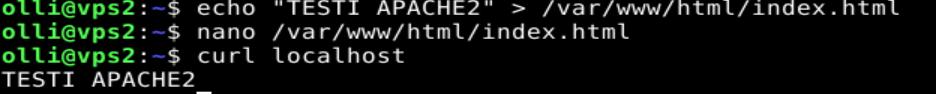

## b) Moottorix
**Päivämäärä:** 17.11.2026

Aloitin laitamalla Apache2 palvelun pois päältä `sudo systemctl stop apache2` ja tarkistin palvelun tilan `systemctl is-active apache2` ja sain viestin palvelun olevan poissa päältä.

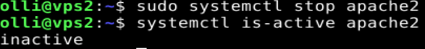
 
Seuraavaksi asensin Nginxin `sudo apt install nginx` ja asennuksen jälkeen tarkistin toimiko se `curl -sI localhost | grep Server` ja palvelin oli vaihtunut Nginxiksi. 

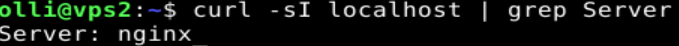

Sivulla luki edelleen Apachen kanssa valittu teksti niin vaihdoin sen vielä kerran `echo "TESTI NGINX" >  /var/www/html/index.html` ja testasin, näkyikö muutos kun Nginx oli käynnissä `curl localhost`. 

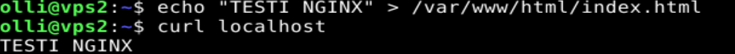
  

## c) Automoottorix
**Päivämäärä:** 17.11.2026

Aloitin menemällä Ansiblen kansioon `cd ansible` ja lisäämällä kohdepalvelimen IP-osoitteen hosts-tiedostoon `nano hosts.ini`. Poistin samalla localhost kohteen sieltä. 

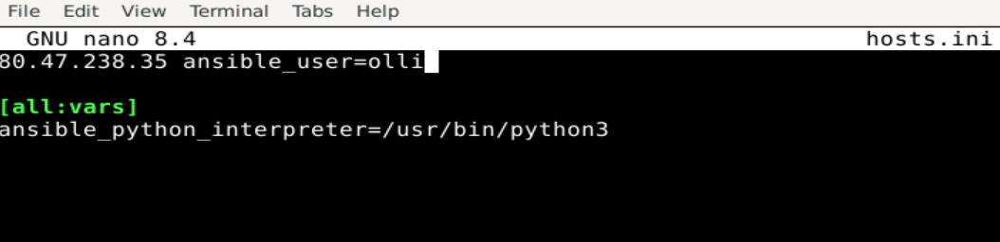

Tämän jälkeen loin uuden kansion Nginxiä varten `mkdir -p roles/nginx/tasks` ja loin sinne main.yml tiedoston `nano roles/nginx/tasks/main.yml`. Tiedostoon lisäsin seuraavat tiedot:

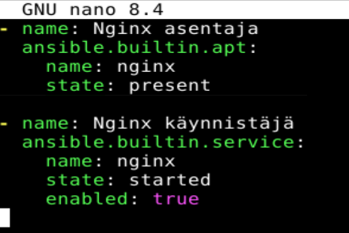

Kun tämä oli valmista, muokkasin vielä site.yml tiedostoa `nano site.yml` ja lisäsin sinne nginx roolin sekä poistin aiemmat roolit, joita siellä oli. 

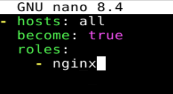

Seuraavaksi  ajoin playbookin `ansible-playbook -i hosts.ini site.yml --ask-become-pass`
ja se toimi tosin Nginx oli jo aiemmin asennettu niin siksi muutoksia ei tullut.

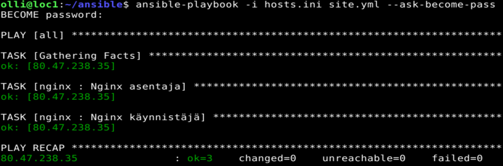

Poistin seuraavaksi nginxin `sudo apt remove nginx` tarkistin palvelun `curl localhost` ja tällä kertaa sain vain virheilmoituksen ettei yhdistäminen onnistunut joten nginx ei ollut enää toiminnassa. Ajoin seuraavaksi playbookin uudelleen `ansible-playbook -i hosts.ini site.yml --ask-become-pass` ja nyt Ansible teki yhden muutoksen eli asensi Nginxin uudelleen. 

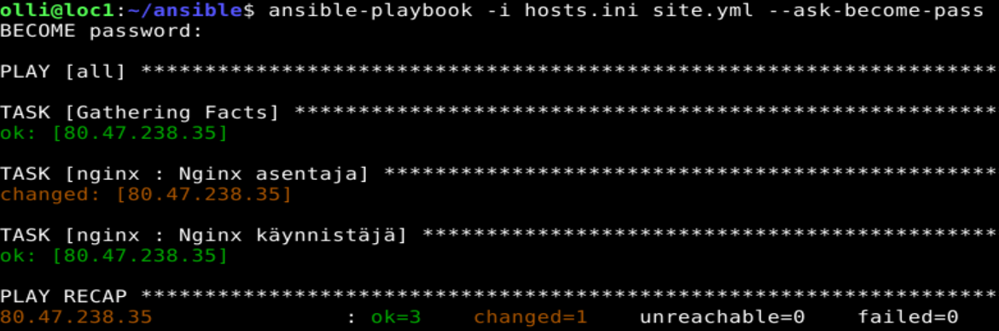

Testasin ajaa playbookin vielä kerran ja nyt muutoksia ei enää tullut. Testasin tämän jälkeen vielä palvelun tilan ja nyt se oli taas toiminnassa, joten kaikki toimi.

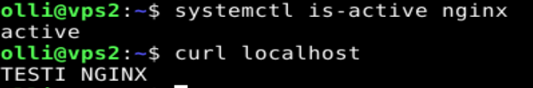

## Lähteet

- Karvinen, T. 2026. Palvelinten Hallinta h3 Demoni. Luettavissa: https://terokarvinen.com/palvelinten-hallinta/ Luettu 17.11.2026
- Karvinen, T. 2026. Apache installed with Ansible - quick notes Luettavissa: https://terokarvinen.com/apache-ansible/ Luettu 17.11.2026
- Ansible Community Documentation: Handlers: running operations on change Luettavissa: https://docs.ansible.com/projects/ansible/latest/playbook_guide/playbooks_handlers.html Luettu 17.11.2026
- OpenAI ChatGPT (GPT-6), tekninen neuvonta Ansiblen ja Linuxin toiminnoista, 17.11.2026
- Hacker News 2026. Claude Code wiped our production database with a Terraform command Luettavissa: https://news.ycombinator.com/item?id=47278720 Luettu 17.11.2026
- Alexey Grigorev 2026. How I Dropped Our Production Database and Now Pay 10% More for AWS Luettavissa: https://aishippingblog.com/p/how-i-dropped-our-production-database/ Luettu 17.11.2026
