# h4 Pizza Fantasia

## x) Lue ja tiivistä
- Size and Complexity of Some DSLs
  
Tässä kerrotaan siitä, miten monimutkaisia ja suuria DSL (Domain-Specific Language) voivat olla. Esimerkkinä annetaan Salt, jossa on 510 state-funktiota ja Puppet, jossa niitä on 113.

Tässä hieman yllätti, miten suuria eroja näissä voi olla. Onkohan Salttiin lisätty jotain erityisiä toimintoja, joita esimerkiksi suuri yritys on tarvinnut. Sitten ne ovat vain jääneet sinne käytettäviksi, vaikka juuri kenelläkään muulla ei kyseisille toiminnoille olisi käyttöä.

- Use of DSL Functions in Case Configuration
  
Vaikka erilaisia vaihtoehtoja on suuri määrä tarjolla, ei niitä kaikkia käytetä läheskään yhtä paljon. Kahdessa esitetyssä esimerkissä top 3 kattoi molemmissa noin 50 % kaikista komennoista, joita käytettiin. Mozilla esimerkissä case, file ja package olivat käytetyimmät. USGCB:n kohdalla augeas, file ja service olivat käytetyimmät.

- Dependencies Between Main Functions
  
Tärkeimmät funktiot ovat package, file, service, user, group, directory sekä symlink. Näiden avulla voidaan oikein yhdistämällä hallita demoneita, sovelluksia, käyttäjiä sekä tiedostoja.

Tässä tuli väkisin mieleen, olisiko jokin huomattavasti karsitumpi systeemi järkevä näiden vanhempien järjestelmien sijaan, mikäli pienelläkin määrällä toimintoja saa hoidettua suurimman osan tehtävistä. Vai olivatko järjestelmät aluksi yksinkertaisempia ja ne ovat vain aikojen saatossa paisuneet näin suuriksi. 

**Tehtävissä käytetyn laitteen tiedot:**

Lenovon kannettava tietokone
- Käyttöjärjestelmä: Win 11 Home
- Prosessori: Intel i7 10th gen
- RAM-muisti: 32 Gt
- Tallennustila: 512 GB

Ohjelmisto ja VM, jolla harjoitus tehty (loc1)
- Virtualisointiohjelma: Oracle VirtualBox
- Käyttöjärjestelmä: Debian GNU/Linux 13 (Trixie)
- Virtuaalikoneen prosessorit: 2 vCPU
- RAM-muisti: 8 Gt
- Virtuaalilevy: 60 Gt, dynaamisesti varattu

VPS-palvelu ja VM  (vps1)
- Palveluntarjoaja: UpCloud
- Käyttöjärjestelmä: Debian GNU/Linux 13 (Trixie)
- Virtuaalikoneen prosessorit: 1 vCPU
- RAM-muisti: 1 Gt
- Virtuaalilevy: 10 Gt

## a) Räpylä
**Päivämäärä:** 24.11.2026

Valitsin asennettavaksi demoniksi Caddyn ja päätin asentaa sen UpCloudissa sijaitsevaan uuteen virtuaalikoneeseen. 
Yhdistin virtuaalikoneelle `ssh root@81.27.100.97` ja päivitin paketit `sudo apt update && sudo apt upgrade`.  Loin uuden käyttäjän `adduser olli` ja valitsin sille salasanan. Lisäsin käyttäjän sudo-ryhmään `adduser olli sudo`  ja loin SSH-kansion `install -d -m 700 -o olli -g  olli /home/olli/.ssh`.  Kopioin vielä avaimet rootilta `install -m 600 -o olli -g olli /root/.ssh/authorized_keys /home/olli/.ssh/authorized_keys`. 
Tämän jälkeen asensin  itse Caddyn `apt install caddy` ja tarkistin asennuksen jälkeen sen tilan `systemctl status caddy`. Tila oli active, joten asennus oli onnistunut.

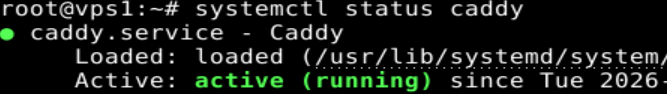

Tämän jälkeen kokeilin selaimella yhdistää palvelimeen ja sain Caddyn tervehdysviestin. 

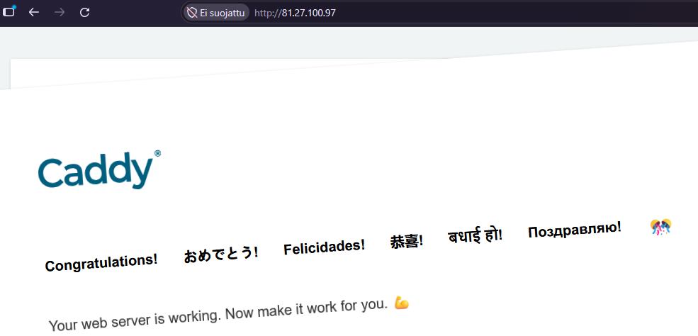

Kävin tämän jälkeen Namecheap sivustolla päivittämässä hankkimani verkkotunnuksen IP-tiedot, koska siellä oli vanhan serverin osoite. 
Kun tiedot olivat päivitetty otin Caddyfile-tiedostosta kopion `cp -a /etc/caddy/Caddyfile /etc/caddy/Caddyfile.bak`. Nyt kun tiedostosta oli kopio, muokkasin alkuperäistä `nano /etc/caddy/Caddyfile` sieltä muokkasin  `:80` kohdan tilalle oman domainnimeni `sekimori.online`. Tämä aiheuttaa sen, että Caddy ottaa automaattisesti HTTPS:n käyttöön, kun se näyttää sivua.

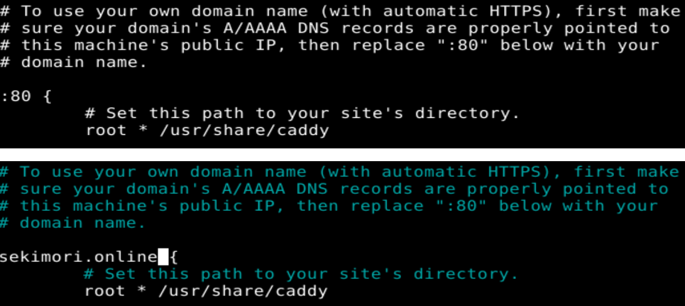

Tarkistin seuraavaksi, että tiedosto oli toimiva `caddy validate --config /etc/caddy/Caddyfile` ja sain vahvistuksen konfiguraation toimivuudesta.

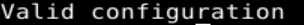

Tämän jälkeen päivitin uudet asetukset Caddyn käyttöön `systemctl reload caddy` ja sen jälkeen varmistin tilan `systemctl status caddy`. Caddy oli käynnissä, joten kokeilin mennä selaimella uudelleen sivuille `sekimori.online` ja nyt sivusto aukesi HTTPS-tilassa ja HTTP-varoitus, joka aiemmin tuli sivustoa avatessa oli poissa.

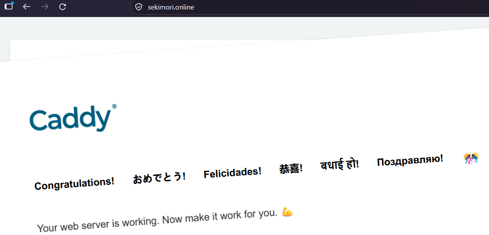

## b) Automaatti
**Päivämäärä:** 24.11.2026

Tämän aloitin menemällä loc1 koneella ansible-kansioon `cd ansible` ja siellä muokkasin hosts.ini-tiedostoa vastaamaan uuden serverin IP-osoitetta ja käyttäjää `nano hosts.ini` 
  
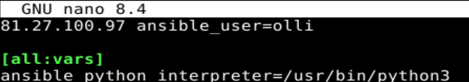

Sitten loin uuden roolin ja kansiot Caddyä varten `mkdir -p roles/caddy/{tasks,files,handlers}`. Tällä käskyllä saadaan luotua kaikki tarvittavat kansiot kerralla. 
Tämän jälkeen loin main.yml-tiedoston `nano roles/caddy/tasks/main.yml` ja lisäsin sinne seuraavat asetukset:

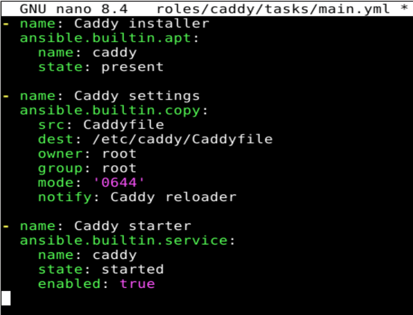

Seuraavaksi loin handlers-kansioon tiedoston main.yml `nano roles/caddy/handlers/main.yml` ja sinne lisäsin nämä tiedot:

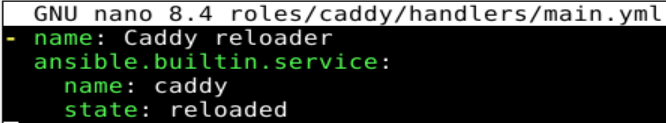

Sitten vuorossa oli Caddyfilen tekeminen `nano roles/caddy/files/Caddyfile` johon kirjoitin nämä tiedot:

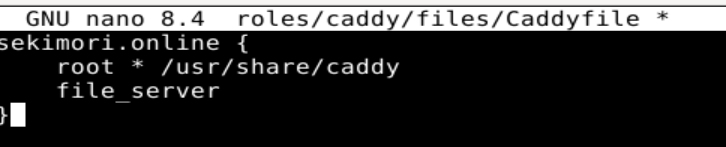

Sitten vuorossa oli vielä site.yml:n päivitys `nano site.yml` johon laitettiin aktiiviseksi rooliksi caddy:

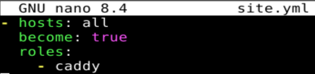

Sitten tarkistin toiminnan ajamalla playbookin `ansible-playbook -i hosts.ini site.yml --ask-become-pass` ja sain virheen:

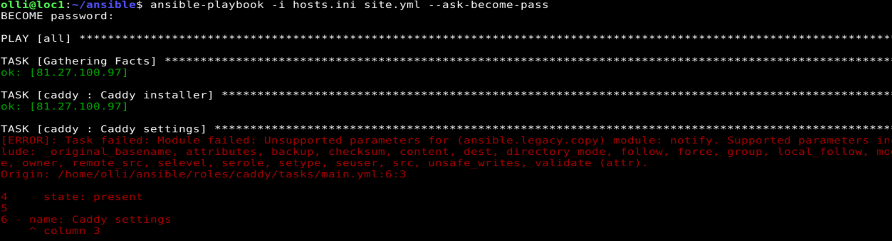

Olin vahingossa laittanut notify-rivin samaan linjaan copy-moduulin asetusten kanssa, jolloin Ansible kaatui siihen, ettei se löytänyt notify-toimintoa copy-moduulin alta. Korjasin virheen siirtämällä notify kohdan paikkaa.

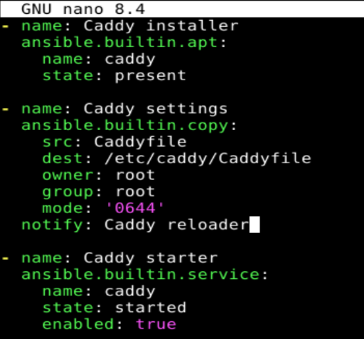

Ajoin playbookin uudelleen `ansible-playbook -i hosts.ini site.yml --ask-become-pass`. Tällä kertaa se toimi ja Ansible teki muutoksia Caddyn tiedostoon ja latasi Caddyn uudelleen.

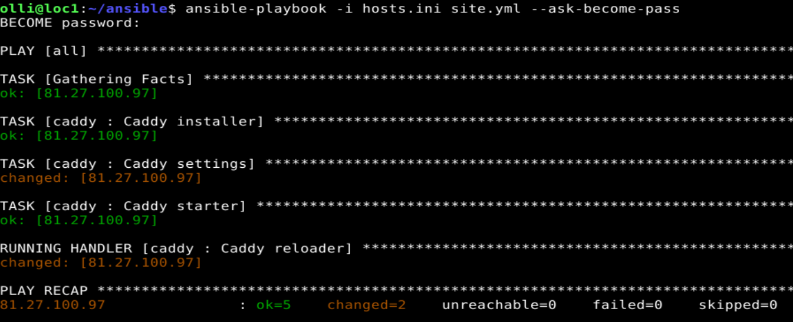

Kokeilin vielä kerran uudelleen ja nyt muutoksia ei enää tullut sekä nettisivu sekimori.online toimi edelleen, kun kävin katsomassa sitä.

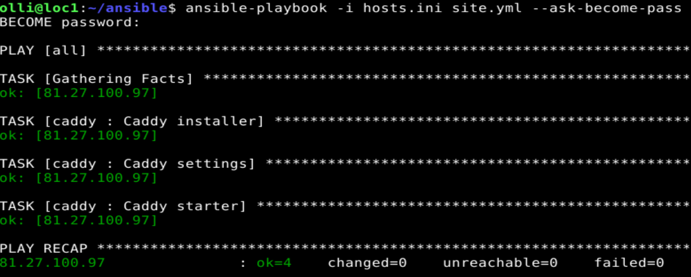

## c) Asetus
**Päivämäärä:** 24.11.2026

Tähän tein vain pienen muutoksen Caddyfilen sisältöön `nano roles/caddy/files/Caddyfile` ja muutin sen antamaan vain tervehdyksen sen sijaan, että vakioalkusivu tulisi näkyviin, kun sivulle menee vierailemaan.

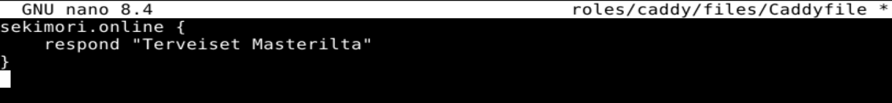

Tämän jälkeen ajoin playbookin uudelleen `ansible-playbook -i hosts.ini site.yml --ask-become-pass` ja muutos astui voimaan.
Ja kun menin katsomaan `sekimori.online` selaimella, sain sinne seuraavan viestin:

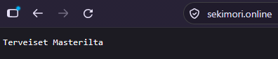

## d) Paikka remonttiin
**Päivämäärä:** 24.11.2026
 
Vaihdoin vps1:n puolelta viestin sisällön `sudo nano /etc/caddy/Caddyfile` ja latasin Caddyn uudelleen `sudo systemctl reload caddy`. Se vaihtoi tervehdyksen, kun latasin selaimen sivulla `sekimori.online`.

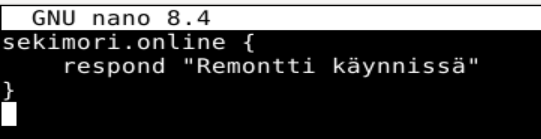
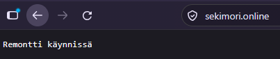

Ajoin sitten uudelleen loc1:n puolelta playbookin `ansible-playbook -i hosts.ini site.yml --ask-become-pass` ja Ansible korjasi tilanteen takaisin haluttuun tilaan, jolloin tervehdys tuli takaisin näkyviin. 

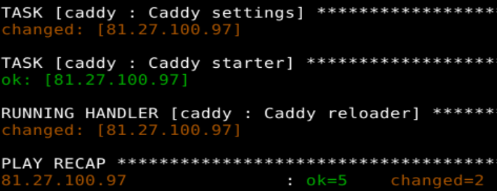
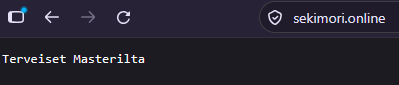

## e) Idempotentti
**Päivämäärä:** 24.11.2026

Ajoin playbookin uudelleen eikä lisää muutoksia tullut.

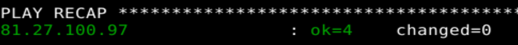

## f) Pari

Pari on hankittu.

## Lähteet

- Karvinen, T. 2026. Palvelinten Hallinta h4 Pizza Fantasia. Luettavissa: https://terokarvinen.com/palvelinten-hallinta/ Luettu 23.11.2026
- Karvinen, T. 2023. Configuration Management of Distributed Systems over Unreliable and Hostile Networks. Luettavissa: https://westminsterresearch.westminster.ac.uk/item/w7vvz/configuration-management-of-distributed-systems-over-unreliable-and-hostile-networks Luettu 23.11.2026
- OpenAI ChatGPT (GPT-6), tekninen neuvonta Ansiblen ja Linuxin toiminnoista, 24.11.2026
